# Bilans & Spółka - case study

> **Projekt koncepcyjny SM-art.** Biuro, zespół, opinie i liczby są fikcyjne. Strona, cennik, wycena, automatyzacja
> i wszystkie pomiary niżej są prawdziwe: działają na https://bilans-i-spolka.vercel.app.

## W jednym zdaniu

Strona biura rachunkowego, która odpowiada na „ile to kosztuje?”, zanim klient zadzwoni - i sama zamienia
wycenę w kontakt: PDF z wyceną w mailu w kilkanaście sekund, gorący lead na telefonie opiekunki, nic nie ginie.

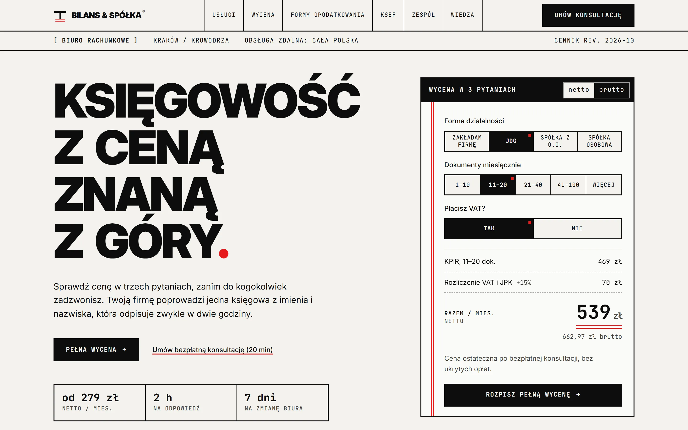

## Dla kogo i po co

**Klient biura** to właściciel JDG albo małej spółki. Zmienia księgowość, bo obecna „nie odbiera telefonu”,
albo zakłada firmę i nie wie, ile to kosztuje ani jaką formę opodatkowania wybrać.

**Odbiorca tego projektu** to właściciel biura rachunkowego, kancelarii albo innej firmy usługowej. Pytanie,
które sobie zadaje: czy taka strona przyniesie mi klientów bez telefonów z pytaniem o cenę?

Pozycjonowanie z briefu: **cena znana z góry, księgowa znana z imienia.**

## Co zrobiliśmy

### 1. Cena, zanim ktoś zadzwoni

Wycena jest bohaterem strony. Trzy pytania na stronie głównej, pięć na `/wycena`, cena zmienia się przy każdym
kliknięciu - rozpisana na pozycje jak na fakturze, netto i brutto, z opiekunką dobraną do formy działalności.
E-mail podaje się dopiero wtedy, gdy ktoś chce PDF albo konsultację.

| Pełna wycena | Podsumowanie na telefonie |
|---|---|
| 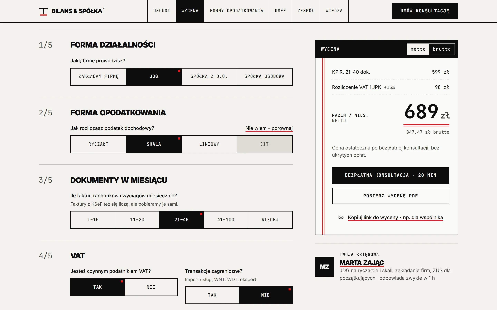 | 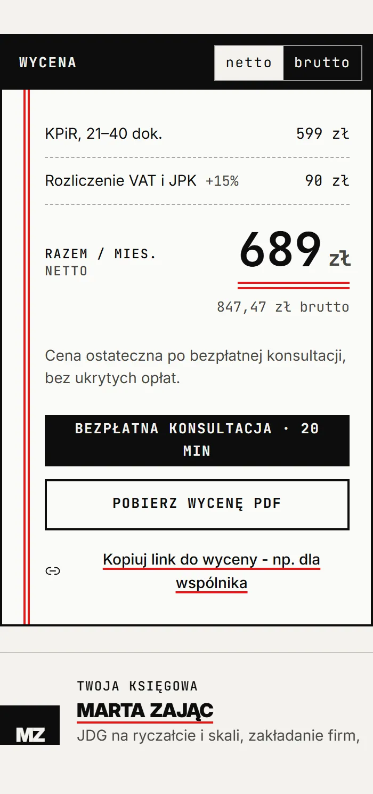 |

Rzeczy, które właściciel biura zauważy:

- **Jedna funkcja liczy cenę w przeglądarce i na serwerze** (ADR-002). Kwota w mailu i w PDF jest przeliczana
  od nowa z cennika - nie da się jej „podkręcić” w przeglądarce.
- **Cennik edytuje biuro, nie programista** - w Sanity, z wersją cennika na wycenie.
- **Link do wyceny zapamiętuje odpowiedzi** - można go wysłać wspólnikowi.
- **Uczciwe granice:** powyżej 100 dokumentów cena jest „od” i zaproszenie do rozmowy.

### 2. Odpowiedzi na pytania, które dziś zajmują telefon

| Porównywarka form opodatkowania | Test gotowości KSeF |
|---|---|
| 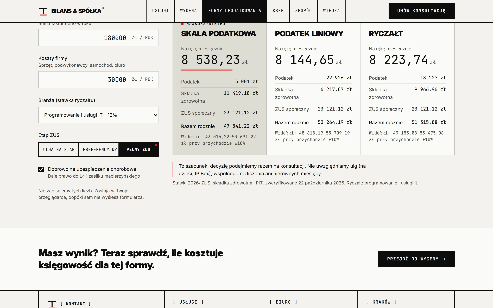 | 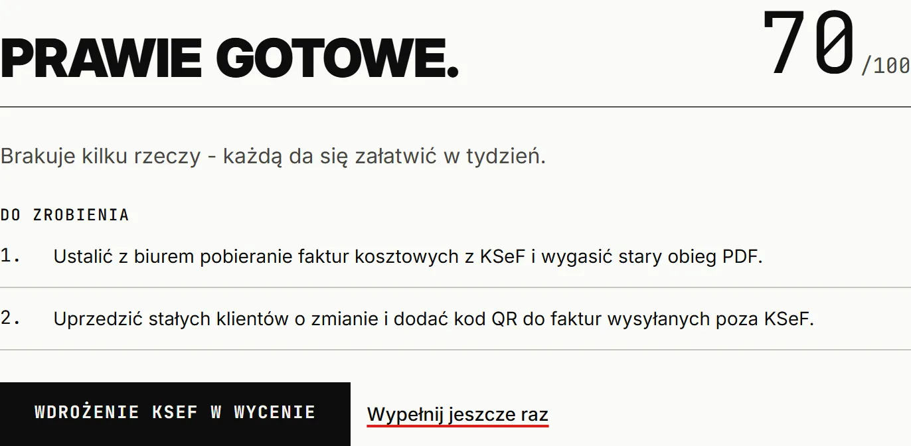 |

- **Skala, liniowy czy ryczałt** na stawkach 2026, w widełkach ±10% - szacunek, decyzja na konsultacji
  (ADR-004). Liczby zostają w przeglądarce.
- **Test KSeF:** pięć pytań, lista braków, bez e-maila, licznik dni do 1 stycznia 2027.
- **Miesiąc księgowy:** oś 1-31 pokazuje, że klient poświęca 5 minut, a biuro pilnuje reszty terminów.

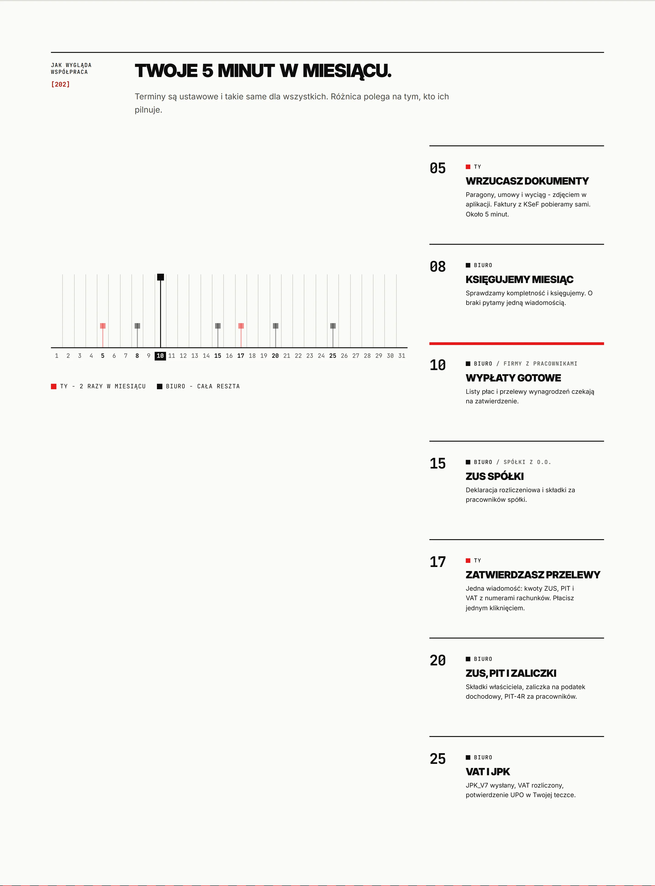

### 3. Od wyceny do kontaktu - bez człowieka po drodze

Formularz (z antyspamem Cloudflare Turnstile) zapisuje zgłoszenie w bazie, **zanim** cokolwiek wyśle dalej.
Potem n8n w kilkanaście sekund:

1. sprawdza podpis i klucz (fałszywe żądanie dostaje 401/403, a biuro alert),
2. pilnuje, żeby ten sam lead nie wyszedł dwa razy,
3. robi PDF z dokumentu wyceny i wysyła mail z notką od Claude,
4. gorący lead (zmiana biura, start od zaraz, telefon) od razu trafia do opiekunki na Telegram,
5. zimny lead ze zgodą marketingową dostaje trzy krótkie maile: KSeF, formy opodatkowania, zmiana biura.

| Mail z wyceną | PDF w załączniku |
|---|---|
| 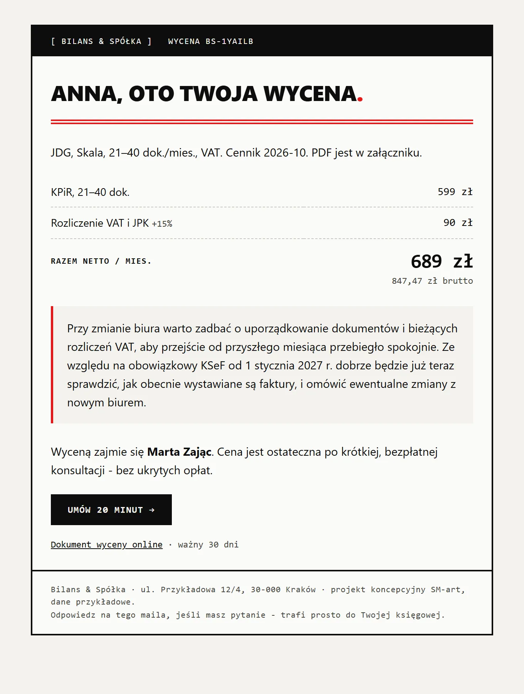 | 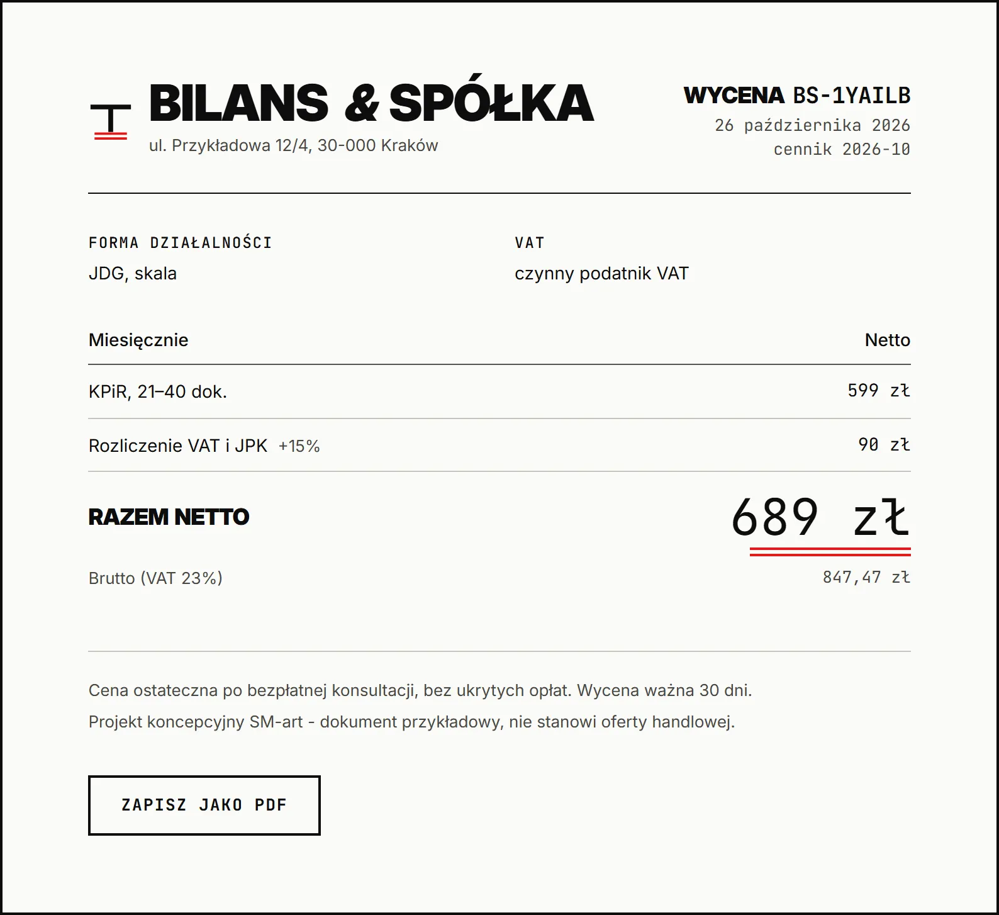 |

[`wycena-przyklad.pdf`](wycena-przyklad.pdf) - ten sam dokument jako PDF A4 (Chromium, media print - tak samo
jak PDF.co w n8n).

**Notka od Claude nigdy nie zawiera kwot** - kwoty pochodzą wyłącznie z cennika, a do modelu nie trafiają imię,
e-mail ani telefon, tylko parametry wyceny. Gdy model nie odpowie, mail idzie bez notki.

**Pierwsze prawdziwe zgłoszenie z produkcji (26.10.2026):** odpowiedź n8n po 2 s, PDF, mail i Telegram po 14 s.
Gdy n8n jest niedostępny, zgłoszenie czeka w bazie, a workflow co 10 minut je dociąga - sprawdzone na tym samym
leadzie. Leady starsze niż 12 miesięcy usuwa codzienny workflow retencji (RODO).

### 4. Wygląd: „druk techniczny”

Zamiast kolejnej „eleganckiej” strony biura - szwajcarski druk techniczny: papier, tusz, jedna czerwień, kąty
proste, widoczne siatki (ADR-012). Granice, żeby klient dalej czytał bez wysiłku:

- **czerwień nigdy przy kwocie** - w księgowości czerwona liczba to strata,
- wersaliki tylko w nagłówkach, tekst ciągły zwykłym zdaniem,
- kwoty w kroju o stałej szerokości z cyframi tabelarycznymi - kolumny się wyrównują,
- ryciny archiwalne z domeny publicznej zamiast stockowych zdjęć „biura”: karta bilansu kasowego z 1898 roku
  - nazwa biura dosłownie - i plan Krakowa z 1836.

| „Bilans się zgadza” | Kraków, Krowodrza |
|---|---|
| 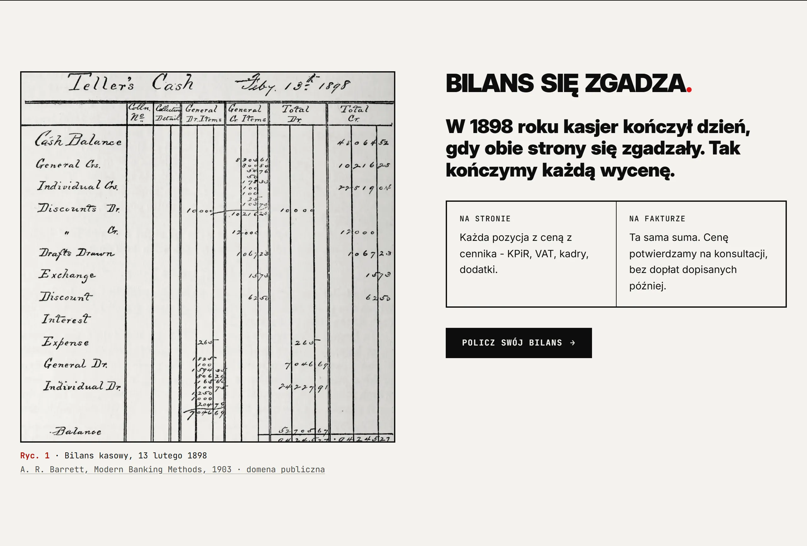 | 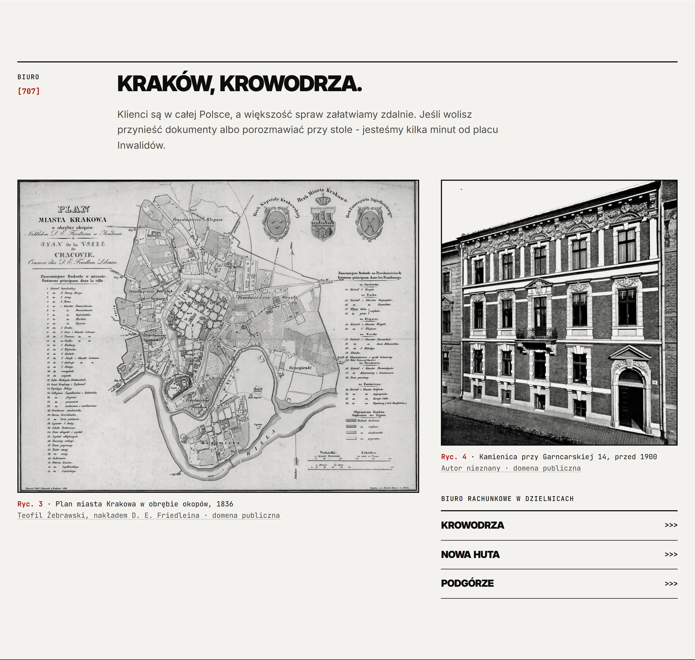 |

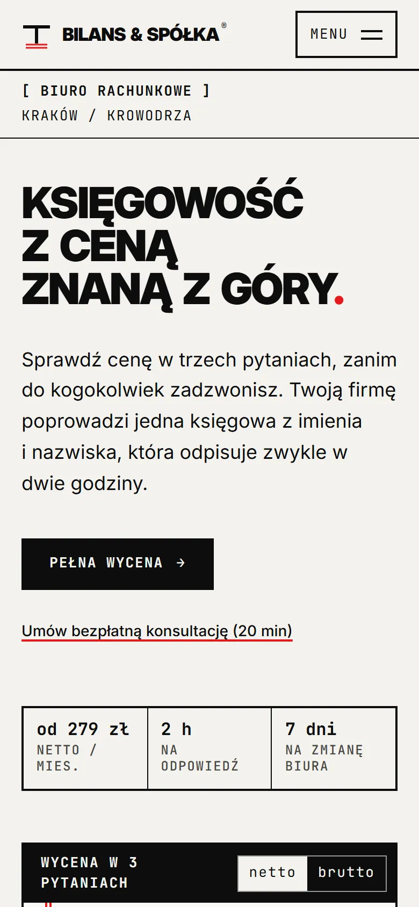

### 5. SEO pod frazy z intencją

Landingi `/biuro-rachunkowe-[dzielnica]` (Krowodrza, Nowa Huta, Podgórze), usługi pod „księgowość dla spółki
z o.o.”, baza wiedzy z autorką i datą aktualizacji, dane strukturalne `AccountingService`, `Person`, `FAQPage`,
`Article` - walidator schema.org bez błędów.

## Wyniki

| Pomiar | Wynik |
| --- | --- |
| Lighthouse CI, mobile, rzeczywiste dławienie, mediana z 5 (`main` 4744b09, 26.10.2026) | `/` 95 · `/wycena` 96 · `/ksef` 98; dostępność, best practices, SEO: 100 |
| LCP w tej samej bramce (cel z briefu 1,8 s) | `/` 1,8 s · `/wycena` 1,7 s · `/ksef` 1,6 s |
| CLS | ≤ 0,002 |
| PageSpeed Insights na produkcji, mobile (24.10.2026, przed zmianą stylu) | `/` 98 · `/wycena` 94 · `/ksef` 98; reszta 100 |
| JavaScript (gzip, budżet w CI) | `/` 162,6 kB · `/wycena` 192,9 kB · `/ksef` 141,6 kB |
| Fonty | 3 pliki, 97 kB, polskie znaki w tym samym pliku co łacina |
| Testy | 72 jednostkowe (cennik, porównywarka, scoring, podpis webhooka, kod węzłów n8n) · 33 e2e w Playwright, w tym axe WCAG 2.2 AA na 9 stronach |
| Automatyzacja (produkcja) | webhook → 202 w 2 s, mail z PDF i Telegram w 14 s; ponowna wysyłka z outboxa sprawdzona |

Raporty Lighthouse z tego przebiegu (tymczasowe, Google trzyma je kilka dni):
[`/`](https://storage.googleapis.com/lighthouse-infrastructure.appspot.com/reports/1793017599738-79375.report.html) ·
[`/wycena`](https://storage.googleapis.com/lighthouse-infrastructure.appspot.com/reports/1793017600097-51814.report.html) ·
[`/ksef`](https://storage.googleapis.com/lighthouse-infrastructure.appspot.com/reports/1793017600533-7048.report.html).
Dlaczego PSI pokazuje wyższe LCP niż bramka CI: ADR-011.

**Uczciwie:** po zmianie stylu strona główna spadła z 99 do 95 w bramce CI, a LCP stoi równo na progu 1,8 s -
przechodzi, ale bez zapasu. Świeżego PSI z produkcji po zmianie stylu nie ma: 26.10 dzienny limit API Google był
wyczerpany.

## Decyzje, które warto opowiedzieć

- **Lead najpierw w bazie, potem webhook** (outbox, ADR-005) - awaria n8n nie gubi zgłoszenia.
- **n8n Cloud bez Variables** (ADR-013) - sekret w zaszyfrowanym poświadczeniu Header Auth, podpis HMAC liczony
  kluczem z już sprawdzonego nagłówka; bez własnego serwera n8n.
- **Pomiar LCP z rzeczywistym dławieniem** (ADR-011) - symulacja PSI liczy do LCP JavaScript, którego tekst nie
  potrzebuje; decyzja opisana, nie ukryta.
- **Model językowy tylko do notki, nigdy do liczb** - i łagodna degradacja: pierwsze zgłoszenie poszło bez notki,
  bo API od 21.10.2026 odrzuca parametr `temperature`; mail i PDF wyszły mimo to, poprawka w kilka minut.

Wszystkie decyzje z uzasadnieniem: [docs/ARCHITECTURE.md](../ARCHITECTURE.md) (ADR-001 - ADR-013).

## Stos

Next.js 16 (App Router, Cache Components) · TypeScript strict · Tailwind CSS 4 · Radix UI · Motion · Zustand ·
React Hook Form + Zod · Sanity · Supabase (Postgres, RLS, funkcje `SECURITY DEFINER`) · n8n Cloud · Claude
(Haiku 5.5) · PDF.co · Resend · Telegram · Cloudflare Turnstile · Vercel (funkcje w Dublinie, obok bazy w UE) ·
Vitest · Playwright + axe · Lighthouse CI.

## Co dalej (poza zakresem koncepcji)

- Cal.com → Documenso → CRM: rezerwacja konsultacji, umowa do podpisu online, lista dokumentów - zaprojektowane
  w [automation/n8n/README.md](../../automation/n8n/README.md), wymaga kont w tych usługach.
- Własna domena i zweryfikowana domena nadawcy w Resend (teraz testowy nadawca `onboarding@resend.dev`).
- Zapas na LCP strony głównej po zmianie stylu.

---

## Materiały

Zrzuty z produkcji (`https://bilans-i-spolka.vercel.app`, `main` 4744b09, 26.10.2026), Playwright w Chromium:
desktop 1440×900, telefon 390×844, DPR 2, polski locale, statystyki zablokowane, bez wysyłania formularzy.
Dokument wyceny i PDF pochodzą z lokalnego buildu tej gałęzi - zawiera poprawkę tła wydruku, której produkcja
jeszcze nie ma. Mail to HTML z węzła n8n `automation/n8n/code/lead.js` dla tej samej wyceny, z notką z prawdziwego
przebiegu. Wycena na zrzutach: JDG, skala, 21-40 dokumentów, VAT = 689 zł netto.

Jak odtworzyć: `node scripts/case-study-shots.mjs https://bilans-i-spolka.vercel.app`.

| Plik | Co pokazuje |
| --- | --- |
| `strona-glowna-desktop.webp`, `strona-glowna-telefon.webp` | pierwszy ekran: nagłówek i wycena w trzech pytaniach |
| `bilans-sie-zgadza-desktop.webp` | sekcja z kartą bilansu kasowego z 1898 |
| `miesiac-ksiegowy-desktop.webp` | oś miesiąca: terminy klienta i biura |
| `krakow-desktop.webp` | plan Krakowa z 1836, kamienica, dzielnice |
| `wycena-desktop.webp`, `wycena-podsumowanie-telefon.webp` | pełna wycena i podsumowanie |
| `porownywarka-desktop.webp` | skala, liniowy, ryczałt obok siebie |
| `ksef-wynik-desktop.webp` | wynik testu KSeF z listą braków |
| `dokument-wyceny-desktop.webp`, `wycena-przyklad.pdf` | dokument wyceny i jego PDF |
| `mail-wycena.webp` | mail z wyceną i notką od Claude |

### Do zrobienia przez Ciebie

Tych zrzutów nie da się zrobić bez Twoich kont. Nazwy plików są przewidziane - wrzuć je tutaj.

- **`telegram-powiadomienie.png`** - wiadomość „🔴 Gorący lead” od bota na telefonie (jest już w czacie z testu
  26.10). Przed publikacją zasłoń imię, mail i telefon z formularza oraz nazwę bota z Ciepła Południa.
  Podpis: „Gorący lead trafia do opiekunki na Telegram kilkanaście sekund po wysyłce formularza.”
- **`n8n-workflow.png`** - `Bilans · lead-created` w edytorze n8n (folder „Bilans & Spółka”), otwarte udane
  wykonanie, żeby węzły miały zielone znaczniki, „Fit view”, okno ~1600 px. Zasłoń dane leada w panelu wykonania.
  Podpis: „Lead przechodzi przez n8n bez udziału człowieka: podpis, ochrona przed duplikatem, PDF, mail, Telegram.”
- **Nagrania:** `nagranie-wycena.mp4` (~30 s: trzy pytania na stronie głównej → pełna wycena → netto/brutto) i
  `nagranie-automatyzacja.mp4` (60-90 s: wysyłka formularza → Telegram → mail z PDF → wykonanie w n8n).
